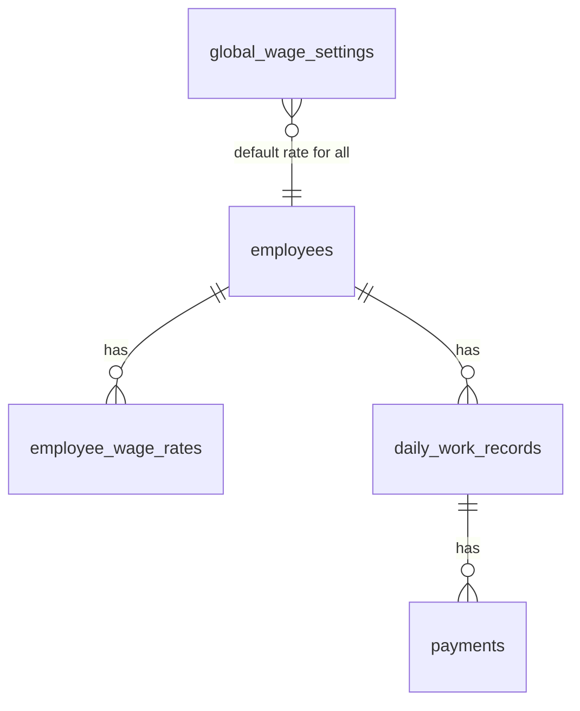

# Daily Wage Calculator — Project Reference

This document summarizes what the **wage_application** codebase contains: purpose, architecture, database tables, and how the frontend and backend fit together. No application code is described for modification here—this is reference only.

---

## What the application does

**Daily Wage Calculator** is an admin-facing app to:

- Register and manage **employees**
- Configure **global** and **per-employee** wage rates (hourly, daily, or monthly) with effective date ranges
- Log **daily work records** with server-side earnings (base, overtime, extra pay) stored as immutable snapshots
- Record **payments** (full or partial) against work records and track **payment status** (`not_paid`, `partially_paid`, `paid`)
- View **dashboard / balance summaries** (totals earned, paid, outstanding)

Currency and amounts use decimal fields in the backend (typically INR in the UI via formatting helpers).

---

## High-level architecture

```
┌─────────────────────────────────────────────────────────────┐
│  Frontend (React 19 + TanStack Router/Start + Vite)         │
│  Routes: / (login), /dashboard, /employees/:id              │
│  src/services/* → HTTP → Django REST API                      │
│  src/utils/wageCalculator.ts → client-side preview rules      │
└───────────────────────────┬─────────────────────────────────┘
                            │ Token auth (VITE_API_BASE_URL)
┌───────────────────────────▼─────────────────────────────────┐
│  Backend (Django 5.2 + Django REST Framework)                 │
│  Apps: employees | wages | work_records                       │
│  Database: PostgreSQL (SQLite in-memory for tests only)       │
│  OpenAPI: /api/docs/, /api/schema/                            │
└─────────────────────────────────────────────────────────────┘
```

**Data access rule (frontend):** UI and routes call **`src/services/*`** only (not raw storage). The in-memory **`src/services/store.ts`** caches entities after API loads; authoritative data lives on the backend.

**Wage math:** Frontend `wageCalculator.ts` documents hourly vs manual-entry rules for daily/monthly. Backend **`work_records/services.py`** and **`wages/services.py`** perform authoritative calculations when work records are created/updated.

---

## Backend structure

| Location | Role |
|----------|------|
| `backend/config/` | Django project settings, root URLs, auth views, permissions |
| `backend/employees/` | Employee CRUD, activate/deactivate, balance & dashboard summaries |
| `backend/wages/` | Global wage settings, employee wage rate history |
| `backend/work_records/` | Daily work records and payments |
| `backend/manage.py` | Django CLI |
| `backend/requirements.txt` | Python dependencies |

### Authentication & authorization

- **DRF Token authentication** (`rest_framework.authtoken`) plus session/basic as configured
- Endpoints: `POST /api/auth/login/`, `POST /api/auth/logout/`, `GET /api/auth/me/`
- Most business APIs require **authenticated admin** (`IsAuthenticatedAdmin`)
- Django built-in **`auth_user`** (and related auth/session tables) used for login; **`authtoken_token`** stores API tokens

### Main API surface (non-exhaustive)

| Area | Examples |
|------|----------|
| Employees | `GET/POST /api/employees/`, `GET/PATCH /api/employees/{id}/`, `POST .../activate/`, `.../deactivate/`, `GET .../balance_summary/`, `GET .../transactions/`, `GET /api/employees/dashboard_summary/`, `GET .../financial_summary/` |
| Wages | `GET/POST /api/wages/global/`, `GET /api/wages/global/history/`, `GET/POST /api/employees/{id}/wage-rates/`, CRUD `/api/wage-rates/` |
| Work & pay | CRUD `/api/work-records/`, CRUD `/api/payments/` |

Pagination: page size **50** by default.

### Backend calculation settings (env)

- `STANDARD_WORKDAY_HOURS` (default 8.0)
- `OVERTIME_RATE_MULTIPLIER` (default 1.0)
- `MONTHLY_DAYS_DIVISOR` (default 30.0)

---

## Frontend structure

| Location | Role |
|----------|------|
| `src/routes/` | File-based routes: login, dashboard (employee list & actions), employee detail (work history) |
| `src/components/` | Dialogs: employee form, work entry, wages, payments, payment history; `AppHeader` |
| `src/components/ui/` | shadcn/Radix UI primitives (buttons, dialogs, tables, etc.) |
| `src/services/` | `api.ts`, `authService`, `employeeService`, `wageService`, `workRecordService`, `paymentService`, `store.ts` |
| `src/types/index.ts` | Backend DTOs (snake_case), frontend models (camelCase), mappers |
| `src/utils/` | `wageCalculator.ts`, `format.ts` (dates, INR) |
| `src/hooks/useAppState.ts` | Subscribes to reactive store |
| `src/test/` | Vitest tests (API, services, wage calculator, routing) |

**Stack:** TypeScript, Vite, TanStack Router/Start, React Query (where used), Tailwind CSS 4, Zod/react-hook-form for forms.

**Dev API default:** `http://127.0.0.1:8000` (override with `VITE_API_BASE_URL`).

---

## Database schema (application tables)

PostgreSQL database name default: **`daily_wage_calculator`**.

### Entity relationship (application data)



Employee-specific rates **override** the applicable global rate for a given date; work records **snapshot** the rate and basis at entry time.

---

### Table: `employees`

| Column | Type | Notes |
|--------|------|--------|
| `id` | BIGINT PK | Auto |
| `name` | VARCHAR(150) | Required |
| `phone_number` | VARCHAR(20) | Nullable |
| `age` | INTEGER | Nullable; check 1–120 if set |
| `is_active` | BOOLEAN | Default true |
| `created_at` | TIMESTAMPTZ | Auto on create |
| `updated_at` | TIMESTAMPTZ | Auto on update |

**Constraints:** `check_employee_age_range`

---

### Table: `global_wage_settings`

Default wage for all employees when no employee-specific rate applies for a date.

| Column | Type | Notes |
|--------|------|--------|
| `id` | BIGINT PK | Auto |
| `wage_amount` | DECIMAL(10,2) | ≥ 0 |
| `wage_basis` | VARCHAR(20) | `hourly` \| `daily` \| `monthly` (default daily) |
| `effective_from` | DATE | Required |
| `effective_to` | DATE | Nullable; must be ≥ `effective_from` if set |
| `created_at` | TIMESTAMPTZ | Auto |

**Constraints:** non-negative amount; valid effective date range

---

### Table: `employee_wage_rates`

| Column | Type | Notes |
|--------|------|--------|
| `id` | BIGINT PK | Auto |
| `employee_id` | BIGINT FK → `employees.id` | ON DELETE PROTECT |
| `wage_amount` | DECIMAL(10,2) | ≥ 0 |
| `wage_basis` | VARCHAR(20) | Same choices as global |
| `effective_from` | DATE | Required |
| `effective_to` | DATE | Nullable |
| `created_at` | TIMESTAMPTZ | Auto |

**Constraints:** non-negative amount; valid effective date range

---

### Table: `daily_work_records`

One row per employee per calendar day (unique pair).

| Column | Type | Notes |
|--------|------|--------|
| `id` | BIGINT PK | Auto |
| `employee_id` | BIGINT FK → `employees.id` | ON DELETE PROTECT |
| `work_date` | DATE | Indexed |
| `hours_worked` | SMALLINT | 0–24, default 0 |
| `minutes_worked` | SMALLINT | 0–59, default 0 |
| `wage_rate` | DECIMAL(10,2) | Snapshot at save time |
| `wage_basis` | VARCHAR(20) | Snapshot |
| `base_amount` | DECIMAL(10,2) | Regular earnings |
| `overtime_minutes` | INTEGER | Default 0 |
| `overtime_amount` | DECIMAL(10,2) | Default 0 |
| `extra_pay` | DECIMAL(10,2) | Bonuses/allowances, default 0 |
| `total_earnings` | DECIMAL(10,2) | base + overtime + extra |
| `notes` | TEXT | Nullable |
| `created_at` | TIMESTAMPTZ | Auto |
| `updated_at` | TIMESTAMPTZ | Auto |

**Constraints:** `unique_employee_work_date`; range checks on hours/minutes; non-negative monetary fields

**Computed in API (not stored columns):** `total_paid`, `balance_due`, `payment_status` derived from related `payments`.

---

### Table: `payments`

Multiple payments can apply to one work record.

| Column | Type | Notes |
|--------|------|--------|
| `id` | BIGINT PK | Auto |
| `work_record_id` | BIGINT FK → `daily_work_records.id` | ON DELETE PROTECT |
| `amount` | DECIMAL(10,2) | Must be > 0 |
| `payment_date` | DATE | Required |
| `payment_method` | VARCHAR(30) | Nullable (Cash, UPI, etc.) |
| `notes` | TEXT | Nullable |
| `created_at` | TIMESTAMPTZ | Auto |

**Constraints:** `check_payment_amount_positive`

---

## Django / framework tables (standard)

When migrations are applied, Django also creates tables such as:

| Table(s) | Purpose |
|----------|---------|
| `django_migrations` | Applied migration history |
| `django_content_type`, `django_admin_log` | Admin framework |
| `auth_user`, `auth_group`, `auth_permission`, M2M tables | User accounts & permissions |
| `django_session` | Session storage |
| `authtoken_token` | DRF API tokens (user ↔ key) |

These are not defined in local `models.py` files but are part of the deployed schema.

---

## Wage basis enum (shared)

Used in `global_wage_settings`, `employee_wage_rates`, and `daily_work_records`:

| Value | Label |
|-------|--------|
| `hourly` | Hourly |
| `daily` | Daily |
| `monthly` | Monthly |

---

## Payment status (API / frontend)

Derived from comparing sum of `payments.amount` to `daily_work_records.total_earnings`:

| Status | Meaning |
|--------|---------|
| `not_paid` | No payments or zero total paid |
| `partially_paid` | Paid > 0 but < total earnings |
| `paid` | Paid ≥ total earnings |

---

## Running locally (quick reference)

**Frontend**

```sh
npm i
npm run dev
```

**Backend** (from `backend/`, with PostgreSQL and `.env` configured)

```sh
pip install -r requirements.txt
python manage.py migrate
python manage.py runserver
```

API documentation when the server is up: `/api/docs/` (Swagger) or `/api/redoc/`.

---

## Related project docs

- `AGENTS.md` — architecture rules (services layer, wage calculator location)
- `README.md` — Lovable / local dev pointer

---

*Generated as a codebase reference. Application source files were not modified when this document was added.*
